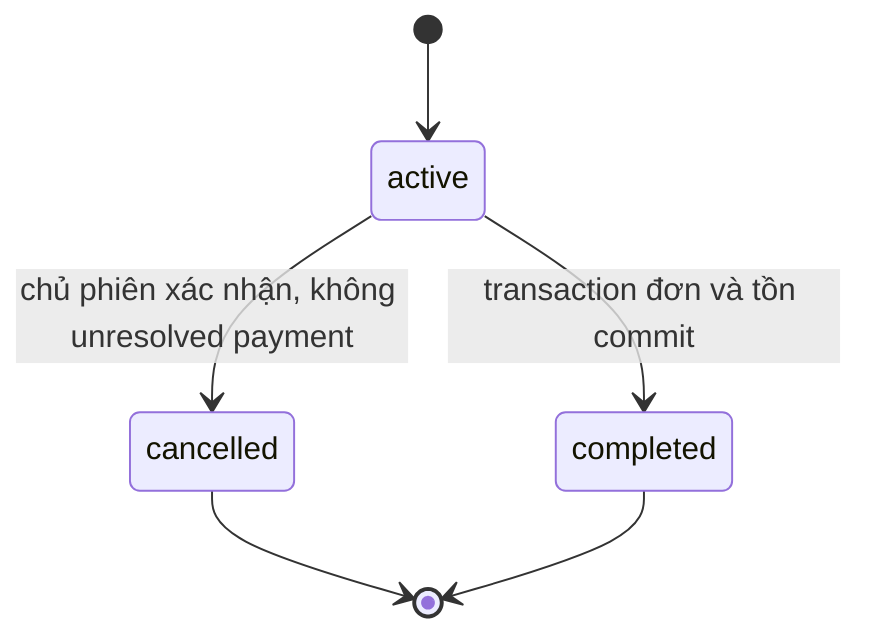

# Đặc tả yêu cầu và nghiệp vụ

Áp dụng backend theo tầng routes/controllers/services/repositories/middlewares; BE và DB host độc lập, Prisma phía server kết nối một database/schema public chung kể cả GatewayPayment. Quyền nghiệp vụ/state do service kiểm tra; repository lọc ownership trong query. Chốt kiến trúc không thay AC hoặc tự chứng nhận refactor.

Nguồn ưu tiên: [kiến trúc đã chốt](design/architecture.md), [quyết định](decisions/decisions.md), [trạng thái bàn giao](handoff/latest.md).

## Danh mục và thuật ngữ

Baseline nguồn gồm 14 FR (10 Must, 3 Should, 1 Could) và 8 NFR (4 Must, 4 Should). Bản tóm tắt nguồn đã được người dùng xóa; yêu cầu triển khai hiện hành nằm tại [requirements/requirements.md](requirements/requirements.md), trace US/AC giữ trong tài liệu này. Giỏ thuộc một phiên khách; payment là một lần thử thanh toán; order là đơn đã hoàn tất; receipt là xác nhận mô phỏng. `unknown` nghĩa chưa biết kết quả, không đồng nghĩa thất bại. Gateway success và hoàn tất nội bộ là hai sự thật khác nhau.

## Use case và AC

| Use case | Tác nhân / tiền điều kiện                 | Luồng chính                                              | Nhánh và hậu điều kiện                                                            |
| -------- | ----------------------------------------- | -------------------------------------------------------- | --------------------------------------------------------------------------------- |
| U001     | Khách có phiên hợp lệ                     | Quét/nhập → U005 → kiểm tra → thêm                       | Camera lỗi dùng tay; mã sai không ghi; D02: xem rồi bấm Thêm                      |
| U002     | Chủ phiên; phiên cho phép sửa             | Xem → đổi lượng/xóa → server tính tổng                   | Xóa/hủy xác nhận; 0 không là xóa; xóa cuối vẫn active                             |
| U003     | Chủ phiên, giỏ khác rỗng, giá được đồng ý | Snapshot → payment → xác minh → hoàn tất đơn/tồn/receipt | Pending/unknown khóa thao tác theo D03; failure không xuất tồn; retry không trùng |
| U004     | Admin đã xác thực                         | Thêm/sửa/ngừng bán sản phẩm                              | Thiếu dữ liệu, giá sai, SKU/barcode trùng bị từ chối; giữ lịch sử                 |
| U005     | Tra cứu công khai có chủ đích             | Nhập barcode/SKU → thông tin sản phẩm                    | Không tạo hàng/giỏ/tồn; mã sai/không thấy/lỗi DB có lỗi riêng                     |
| U006     | Staff/Admin có quyền                      | Danh sách → chi tiết → làm mới                           | Chỉ đọc; dữ liệu cũ có cảnh báo; không tự xác nhận payment                        |
| U007     | Admin                                     | Xem/tìm tồn, phân trang                                  | 0 hợp lệ; không nhập kho/kiểm kê                                                  |
| U008     | Admin                                     | Chọn khoảng → đếm giao dịch → doanh thu                  | Doanh thu chỉ completed; khoảng sai báo lỗi; trống = 0                            |

U001 include U005. U001/U002 chuẩn bị U003; chỉ U003 hoàn tất đơn và xuất tồn. Staff không tham gia với quyền xác nhận thanh toán.

AC nguồn US01–US12 nằm tại [kế hoạch, mục 5](Ke_hoach_trien_khai_Smart_Self_Checkout.md), giữ ID `USxx-ACn`. Các AC bổ sung dưới đây mang hậu tố `-R` để không làm đổi ID nguồn; đều là dự thảo.

| ID      | Given                                               | When                               | Then                                                                 |
| ------- | --------------------------------------------------- | ---------------------------------- | -------------------------------------------------------------------- |
| US01-R1 | Mã không tồn tại                                    | Tra cứu nhiều lần                  | Không tạo bất kỳ product/cart/movement nào                           |
| US02-R1 | Request thêm đã commit nhưng response mất           | Gửi lại cùng operation key/payload | Trả kết quả cũ, không tăng thêm; key mới là lần thêm chủ động mới    |
| US03-R1 | Camera giải mã nhiều frame cùng lượt                | Đọc được mã                        | D02 đã chọn: dừng stream, xem rồi bấm Thêm                           |
| US04-R1 | Giỏ version đã đổi                                  | PATCH bằng version cũ              | 409, không ghi; UI tải lại và cho khách kiểm tra                     |
| US05-R1 | Payment pending/unknown                             | Hủy hoặc sửa qua API trực tiếp     | D03 đã chọn: 409, trạng thái và dữ liệu không đổi                    |
| US06-R1 | Giá mới khác giá khách vừa xem                      | Xác nhận thanh toán                | Báo giá mới, chưa gọi gateway đến khi khách đồng ý lại               |
| US07-R1 | Gateway success đã xác minh, transaction nội bộ lỗi | Tải lại payment                    | Hiển thị đã xác minh nhưng đang hoàn tất/đối soát, không cho trả lại |
| US08-R1 | Hai callback success đồng thời                      | Hoàn tất cùng payment              | Một order/receipt/movement mỗi dòng; tồn chỉ giảm một lần            |
| US09-R1 | Hai request tạo cùng SKU khác hoa/thường            | Commit cạnh tranh                  | Đề xuất unique SKU chuẩn hóa: chỉ một thành công, request kia 409    |
| US10-R1 | Có giữ hàng theo D05                                | Xem tồn                            | Tách on-hand/reserved/available; giữ hàng không phải xuất bán        |
| US11-R1 | Staff có quyền xem phiên                            | Gửi request sửa giỏ hoặc success   | Từ chối; không có endpoint override ngầm                             |
| US12-R1 | Callback trùng và đơn sát biên thời gian            | Lọc khoảng [start,end)             | Chỉ cộng order completed một lần; đúng múi giờ đã duyệt              |

## Mười bất biến

| ID     | Quy tắc                                                         | Cơ chế dự kiến / test                 |
| ------ | --------------------------------------------------------------- | ------------------------------------- |
| INV-01 | Phiên/giỏ cô lập                                                | Ownership backend; T-02               |
| INV-02 | Tra cứu không ghi/không tự tạo hàng                             | GET thuần đọc; T-01                   |
| INV-03 | Tổng = Σ(đơn giá × quantity nguyên dương) từ server             | Tiền chính xác, validation; T-03      |
| INV-04 | Không trả giỏ trống/phiên hủy                                   | State guard; T-04                     |
| INV-05 | Backend xác minh mới được hoàn tất                              | Gateway adapter; T-05                 |
| INV-06 | Pending/unknown không là failure                                | State machine, khóa attempt mới; T-06 |
| INV-07 | Một đơn/receipt/xuất tồn dù callback lặp; success không hồi quy | Unique + guard; T-07                  |
| INV-08 | Đơn và tồn cùng commit/rollback                                 | Chung DB transaction; T-08            |
| INV-09 | Quyền thực thi backend, Staff không thành Admin                 | Deny default; T-09                    |
| INV-10 | Doanh thu chỉ completed, không cộng hai lần                     | Tổng từ orders; T-10                  |

ID T tham chiếu [test plan](04-test-plan.md). Không coi cơ chế dự kiến là đã triển khai.

## Ma trận quyền đề xuất

| Thao tác                     | Khách          | Staff                   | Admin                   | Giới hạn đối tượng/trạng thái                                    |
| ---------------------------- | -------------- | ----------------------- | ----------------------- | ---------------------------------------------------------------- |
| Tra cứu sản phẩm đang bán    | Có             | Có                      | Có                      | DTO công khai, không trả dữ liệu nội bộ                          |
| Tạo phiên                    | Có             | Không qua quyền nhân sự | Không qua quyền nhân sự | Cấp bằng chứng sở hữu mới                                        |
| Đọc/sửa giỏ khách            | Chủ phiên      | Chỉ đọc qua giám sát    | Chỉ đọc qua giám sát    | Đọc bằng ownership; sửa chỉ active/unlocked                      |
| Hủy phiên                    | Chủ phiên, D03 | Không                   | Không                   | Không unresolved payment                                         |
| Tạo/xem payment, đọc receipt | Chủ phiên      | Trạng thái qua giám sát | Trạng thái qua giám sát | Không mặc định cấp receipt cho nhân sự                           |
| Gửi kết quả gateway          | Không          | Không                   | Không                   | Chỉ adapter đã xác minh, không là quyền Admin                    |
| Ghi danh mục/ngừng bán       | Không          | Không                   | Có                      | State/unique/version/audit                                       |
| Xem tồn/báo cáo              | Không          | Không                   | Có                      | Phân trang/filter allowlist                                      |
| Danh sách/chi tiết giám sát  | Không          | Có nếu được cấp         | Có                      | Phạm vi cửa hàng/phiên phải được TL chốt, không suy ra đa tenant |

Khách dùng ID phiên đoán đúng vẫn không đủ quyền. Backend kiểm tra tại service và query, không dựa trên role selector của prototype. D06 đã chọn session server/cookie cùng origin; TTL, thu hồi, CSRF/CORS chi tiết vẫn cần đặc tả.

## Vòng đời đề xuất

Phiên active vẫn có thể bị khóa bởi payment unresolved; không cần suy ra giỏ được sửa từ tên active. Hết hạn phiên và thời gian dọn dữ liệu thuộc D06/D11, chưa thêm trạng thái expired vào baseline.

| Đối tượng / từ                | Sang                    | Điều kiện / thực hiện                                | Cấm                                                    |
| ----------------------------- | ----------------------- | ---------------------------------------------------- | ------------------------------------------------------ |
| payment: initiating           | pending                 | Adapter nhận reference, hệ thống lưu                 | Gọi gateway trong DB transaction                       |
| initiating/pending            | unknown                 | Timeout/response mất, chưa chứng minh failure        | Tạo attempt mới hoặc tự mở giỏ                         |
| pending/unknown/initiating    | success                 | Backend xác minh kết quả + amount/currency/reference | UI tự gửi success để được chấp nhận                    |
| pending/unknown/initiating    | failure                 | Backend có kết quả failure xác định                  | Coi timeout là failure                                 |
| success/failure               | giữ nguyên              | Duplicate cùng kết quả chỉ trả ACK                   | Hồi quy success; callback terminal mâu thuẫn tự ghi đè |
| success + completion: waiting | completed               | Commit order/items/stock/receipt                     | Hiển thị có đơn trước commit                           |
| success + completion: waiting | reconciliation_required | Lỗi DB/tồn, bằng chứng success vẫn giữ               | Chuyển gateway status thành failure/unknown            |
| reconciliation_required       | completed               | Retry cùng payment theo D05, atomic                  | Thu lại tiền hoặc tạo đơn mới ngoài ràng buộc          |

`initiating` và `completionStatus` là đề xuất kỹ thuật, không đổi FR-09. Callback failure rồi success cùng reference là mâu thuẫn cần quarantine + query gateway theo D07; không tự mở lần thanh toán tiếp nếu chưa chắc kết quả terminal. Prototype hiện gộp thiếu tồn vào UNKNOWN; triển khai backend cần tách bằng chứng gateway và hoàn tất nội bộ.

## Phân loại dữ liệu

| Loại                         | Mức / ai đọc                                      | Bảo vệ / lưu giữ                                           |
| ---------------------------- | ------------------------------------------------- | ---------------------------------------------------------- |
| Catalog công khai            | Thường / mọi người có chủ đích                    | Chỉ trường cần bán; ngừng bán giữ mã và lịch sử            |
| Giỏ/phiên                    | Nội bộ / chủ phiên, giám sát có quyền             | Không thu PII khách nếu không cần; TTL TBD D11             |
| Tài khoản nhân sự            | Nhạy cảm / identity service                       | Hash mật khẩu, không DTO/log; retention/ẩn danh TBD        |
| Cookie/token/khóa gateway/DB | Bí mật / runtime được cấp quyền                   | Ngoài git, không log; TTL/rotation D06/D07                 |
| Payment/order/receipt        | Giao dịch demo / chủ phiên và vai trò đã cho phép | Snapshot bất biến, backup; giữ suốt kỳ đồ án theo D11      |
| Audit/log/backup             | Nội bộ hoặc nhạy cảm / OPS được cấp               | Log 30 ngày; backup hằng ngày giữ 7 bản; audit TTL còn TBD |

Không tự đặt thời hạn pháp lý cho giao dịch mô phỏng. D11 đã chốt retention giao dịch/log/backup trong [decisions/decisions.md](decisions/decisions.md); TTL phiên/auth/audit/idempotency còn thiếu trước G3; trước G8 phải thử quy trình dọn/restore không phá lịch sử và idempotency.

## Decision log

Người dùng xác nhận “Chọn toàn bộ A” ngày 05/11/2026. **D01–D12: ACCEPTED ở mức phương án**; thông tin nhân sự/ngày cụ thể D10 và thông số chưa đề xuất không được tự điền. Bản ghi hiện hành: [decisions/decisions.md](decisions/decisions.md); bản chọn A ban đầu tại [decisions/decisions.md](decisions/decisions.md). Vai trò phụ trách chưa có tên được phân công.

| ID  | Quyết định đã chọn                                                                      | Chi tiết còn thiếu                              |
| --- | --------------------------------------------------------------------------------------- | ----------------------------------------------- |
| D01 | React/TypeScript/Vite + Express/TypeScript + PostgreSQL/Prisma                          | Phiên bản, test tools, migration configuration  |
| D02 | Đọc mã → xem → bấm Thêm                                                                 | Kiểm chứng decoder/thiết bị                     |
| D03 | Khách tự sửa/xóa/hủy có xác nhận; khóa khi unresolved                                   | Test state/version/ownership                    |
| D04 | Chốt giá khi xác nhận, đổi giá đồng ý lại, snapshot bất biến                            | Contract và giới hạn tiền                       |
| D05 | Giữ hàng trước gateway, success xuất bán, failure xác minh mới giải phóng               | Expiry/reconcile/locking                        |
| D06 | Session server/cookie cùng origin, khách không đăng ký                                  | TTL/CSRF/revocation/session store               |
| D07 | Mock gateway riêng, callback xác minh + query trạng thái                                | Signature/replay/retry/timeout/ACK              |
| D08 | Làm mới thủ công kèm thời điểm cập nhật                                                 | DTO asOf, stale UI                              |
| D09 | Seed dev/demo; xử lý lệch tồn theo quy trình quản trị                                   | Dataset, người phụ trách                        |
| D10 | Must → Should → Could; lịch theo nguồn lực thật                                         | Tên người, deadline, thiết bị, lịch thử         |
| D11 | Giao dịch suốt kỳ đồ án, log 30 ngày, backup hằng ngày giữ 7 bản; RPO ≤24h/RTO ≤60 phút | TTL loại khác, ngày kết thúc, restore rehearsal |
| D12 | Demo không tiền thật, mức Chuẩn                                                         | Đánh giá lại khi đổi phạm vi                    |

Bổ sung cần chốt kèm D04/D07/D10: currency VND, múi giờ báo cáo Asia/Ho_Chi_Minh, giới hạn code/quantity/tiền và body; đều là đề xuất. Story phụ thuộc quyết định mở chưa Ready. Gate G3 chưa đánh giá; thiếu quyết định/chứng cứ không được ký PASS.
