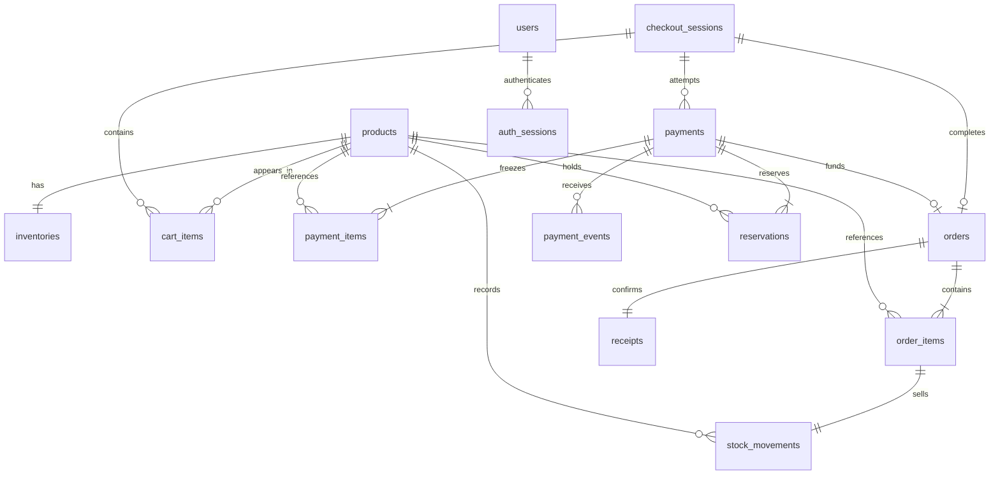

# Thiết kế dữ liệu

Trạng thái: REFERENCE | Chủ sở hữu: BE/TL | Ngày: 2026-11-05 | Liên quan D: D01–D12

Đối chiếu triển khai mới nhất: [giai đoạn3](progress/stage-3.md). Các kết quả lịch sử và yêu cầu chưa có bằng chứng giữ đúng phạm vi thời điểm lập.

## Đối chiếu kiến trúc hiện hành

Dictionary snake_case/bigint/payment_items dưới đây là mô hình thiết kế ban đầu, không phải schema đã chạy. Schema hiện có là prisma/schema.prisma, mô tả tại [design/data.md](design/data.md). Đích hosting dùng một PostgreSQL database/schema public chung cho bán hàng và GatewayPayment. BE kết nối DB qua Prisma ở repository; service điều phối transaction. Không tách DB/schema theo nghiệp vụ hoặc mock gateway.

Nguồn ưu tiên: [kiến trúc đã chốt](design/architecture.md), [quyết định](decisions/decisions.md), [trạng thái bàn giao](handoff/latest.md).

Ngày lập: 05/11/2026. **REFERENCE — mô hình ứng viên ban đầu; schema/migration thực tế hiện có được mô tả tại design/data.md.** Owner: BE/TL. [Yêu cầu và trạng thái](02-requirements.md); [API](03-api.md).

## Phạm vi và quy ước

D01 đã chọn PostgreSQL + Prisma; phiên bản/cấu hình migration chưa pin. D12 đã chọn mức Chuẩn cho demo. S1 cần products, checkout_sessions, cart_items và ownership; S3 mở rộng payment/snapshot/order/inventory/reservations theo D05 đã chọn. Xem [quyết định A](decisions/decisions.md).

Tên bảng số nhiều, snake_case; PK `id uuid` sinh ngẫu nhiên bằng thư viện runtime đã chọn, không có giá trị mặc định cố định. Mọi bảng nghiệp vụ có `created_at`, `updated_at timestamptz NOT NULL DEFAULT now()`; service cập nhật updated_at. Bảng append-only dùng created_at, không updated_at. Các cột không ghi nullable đều NOT NULL; không có default trừ khi nêu rõ. FK đều `ON DELETE RESTRICT` trong thiết kế này. Mã nghiệp vụ không thay PK.

Tiền dùng bigint đơn vị đồng và `currency char(3)`; đề xuất chỉ VND. API tiền dạng chuỗi số nguyên để tránh vượt độ chính xác JSON. Thời điểm UTC; báo cáo [start,end), hiển thị múi giờ chờ duyệt. Không float/double/money. 3NF mặc định; snapshot là dữ liệu lịch sử độc lập, không phải cache giá catalog.

## ERD khái niệm và logic

Khái niệm: một phiên có giỏ nhiều sản phẩm và nhiều lần thử thanh toán; một lần thử có snapshot nhiều dòng; một phiên tối đa một đơn hoàn tất; một đơn có nhiều dòng và một xác nhận; sản phẩm có một bản tồn và nhiều bút toán. Người dùng nhân sự tách khỏi phiên khách không cần đăng ký.

`||--|{` là yêu cầu nghiệp vụ có ít nhất một dòng, cần service kiểm tra trong transaction, FK không tự bảo đảm tồn tại dòng con. Receipt/movement có thể chỉ xuất hiện cùng commit hoàn tất, không tạo bản ghi đơn nửa vời. Kiểm tra payment, order cùng session bằng composite FK hoặc constraint trigger được TL duyệt, không chỉ FK riêng rẽ.

## Từ điển vật lý dự thảo

Bảng dưới cộng các cột chung phía trên là tập cột ứng viên. Đây là đặc tả vật lý để rà soát, chưa phải DB đã kiểm chứng. Thông số độ dài/giới hạn là đề xuất cần TL/PO chốt.

| Bảng / mục đích / nhóm                             | Cột nghiệp vụ: kiểu, null/default                                                                                                                                                                                                                                                                    | Ràng buộc                                                                                                                                                                                                                                      |
| -------------------------------------------------- | ---------------------------------------------------------------------------------------------------------------------------------------------------------------------------------------------------------------------------------------------------------------------------------------------------- | ---------------------------------------------------------------------------------------------------------------------------------------------------------------------------------------------------------------------------------------------- |
| products / danh mục / tham chiếu                   | sku varchar(64); barcode varchar(64); name varchar(200); unit_price bigint; currency char(3); image_url varchar(2048) nullable; is_active boolean default true; version integer default 1; created_by, updated_by uuid nullable FK users                                                             | PK id; unique upper(sku); unique barcode; trim mã không rỗng; price ≥0; version >0; currency = VND theo D04; image chỉ metadata, không fetch URL tùy ý                                                                                         |
| checkout_sessions / phiên khách / nghiệp vụ        | status varchar(16) default active; owner_proof_hash varchar(255); expires_at timestamptz; version integer default 1                                                                                                                                                                                  | PK id; status active/completed/cancelled; version >0; hash không DTO/log; TTL D06; không dùng ID thay proof                                                                                                                                    |
| cart_items / dòng giỏ / nghiệp vụ                  | session_id uuid FK checkout_sessions; product_id uuid FK products; quantity integer; unit_price bigint; currency char(3)                                                                                                                                                                             | PK id; unique(session_id,product_id); quantity >0; price ≥0; currency nhất quán phiên; giá giỏ là giá hiển thị tạm, reprice theo D04                                                                                                           |
| payments / attempt / giao dịch                     | session_id uuid FK checkout_sessions; status varchar(16) default initiating; completion_status varchar(32) default waiting; amount bigint; currency char(3); gateway_reference varchar(128) nullable; version integer default 1; verified_at timestamptz nullable; completed_at timestamptz nullable | PK id; unique gateway_reference khi khác null; unique(id,session_id); amount ≥0; status initiating/pending/unknown/success/failure; completion waiting/completed/reconciliation_required; completed chỉ khi success và completed_at có giá trị |
| payment_items / snapshot trước gateway / giao dịch | payment_id uuid FK payments; product_id uuid FK products; product_name varchar(200); sku,barcode varchar(64); unit_price bigint; quantity integer                                                                                                                                                    | PK id; unique(payment_id,product_id); quantity >0, price ≥0; bất biến sau khởi tạo; line total tính unit_price × quantity                                                                                                                      |
| payment_events / bằng chứng đã xác minh / nhật ký  | payment_id uuid FK payments; provider_event_id varchar(128); payload_digest varchar(128); reported_status varchar(16); amount bigint; currency char(3); received_at timestamptz default now(); processed_at timestamptz nullable                                                                     | PK id; unique provider_event_id trong scope provider đã chốt; append-only payload, cập nhật processed_at có kiểm soát; không lưu raw secret/signature; chỉ lưu event đã kiểm tra hoặc tách log reject                                          |
| idempotency_records / retry bền vững / nghiệp vụ   | session_id uuid FK checkout_sessions; operation varchar(64); key_digest varchar(128); payload_digest varchar(128); payment_id uuid nullable FK payments; response_body jsonb nullable; response_status smallint nullable; expires_at timestamptz                                                     | PK id; unique(session_id,operation,key_digest); result JSON chỉ DTO đã lọc; D07 chốt thời hạn; ghi kết quả cùng transaction nghiệp vụ                                                                                                          |
| orders / đơn hoàn tất / giao dịch                  | session_id uuid FK checkout_sessions; payment_id uuid FK payments; status varchar(16) default completed; currency char(3); completed_at timestamptz                                                                                                                                                  | PK id; unique session_id; unique payment_id; CHECK status = completed; composite FK(payment_id,session_id) → payments(id,session_id) RESTRICT; không tồn tại đơn completed rỗng                                                                |
| order_items / snapshot bán / giao dịch             | order_id uuid FK orders; product_id uuid FK products; product_name varchar(200); sku,barcode varchar(64); unit_price bigint; quantity integer                                                                                                                                                        | PK id; unique(order_id,product_id); quantity >0; price ≥0; sao từ payment_items, không đọc giá catalog để dựng receipt                                                                                                                         |
| receipts / định danh xác nhận / giao dịch          | order_id uuid FK orders; issued_at timestamptz default now()                                                                                                                                                                                                                                         | PK id; unique order_id; nội dung dựng từ order/items, không lưu bản sao tổng mâu thuẫn                                                                                                                                                         |
| inventories / số tồn hiện tại / nghiệp vụ          | product_id uuid FK products; on_hand integer; reserved integer default 0; version integer default 1                                                                                                                                                                                                  | PK id; unique product_id; 0 ≤ reserved ≤ on_hand; available = on_hand - reserved; version >0; tạo cùng product; chỉ dịch vụ hoàn tất được xuất bán                                                                                             |
| stock_movements / xuất bán bất biến / giao dịch    | product_id uuid FK products; order_item_id uuid FK order_items; quantity_delta integer; reason varchar(16) default sale                                                                                                                                                                              | PK id; unique order_item_id; delta <0; reason = sale; kiểm tra product và -delta khớp order_item; append-only                                                                                                                                  |
| users / nhân sự / nhạy cảm                         | username varchar(100); password_hash varchar(255); role varchar(16); is_active boolean default true                                                                                                                                                                                                  | PK id; unique lower(username); role staff/admin; không cho sửa role qua DTO catalog; không seed password cố định                                                                                                                               |
| auth_sessions / đăng nhập nhân sự / nhạy cảm       | user_id uuid FK users; proof_hash varchar(255); expires_at timestamptz; revoked_at timestamptz nullable                                                                                                                                                                                              | PK id; unique proof_hash; không trả hash; TTL/rotation D06                                                                                                                                                                                     |
| payment_status_history / lịch sử / nhật ký         | payment_id uuid FK payments; from_status,to_status varchar(16); reason_code varchar(64); request_id varchar(128); actor_user_id uuid nullable FK users                                                                                                                                               | PK id; trạng thái cùng miền payments; append-only; actor null nghĩa hệ thống, không phải mất dữ liệu                                                                                                                                           |
| audit_logs / thao tác nhạy cảm / nhật ký           | actor_user_id uuid nullable FK users; product_id uuid nullable FK products; session_id uuid nullable FK checkout_sessions; payment_id uuid nullable FK payments; reservation_id uuid nullable FK reservations; action varchar(64); request_id varchar(128); outcome varchar(32)                      | PK id; dùng FK tường minh; CHECK đúng một đích nghiệp vụ cho sự kiện nghiệp vụ; auth event không có đích phải có action riêng được allowlist; append-only                                                                                      |

Mỗi bảng có PK id theo quy ước chung. FK tự tham chiếu audit created_by cho users không được ngầm thêm. Payment/event/order/movement được cập nhật chỉ qua use case cho phép, không có CRUD công khai. CHECK chỉ kiểm tra miền, chuyển trạng thái cần conditional update và lịch sử cùng transaction.

Tổng giỏ/đơn được tính Σ(unit_price × quantity); không lưu tổng order thêm một nguồn sự thật. payments.amount là số tiền đã đóng băng, phải khớp tổng payment_items bằng service trong transaction và test. Nếu cần DB trigger bảo vệ tổng xuyên dòng, ghi ADR trước triển khai. Không thêm thuế, giảm giá hoặc PII khách chưa được yêu cầu.

## Tính duy nhất và liên kết xuyên bảng

- SKU chuẩn hóa upper(trim), barcode giữ chuỗi và số 0 đầu; không tái sử dụng mã khi ngừng bán theo đề xuất. Unique ở DB, không chỉ pre-check API.
- Partial unique một attempt unresolved trên session: initiating/pending/unknown, hoặc success nhưng completion chưa completed. PostgreSQL index chỉ dùng cột cùng bảng; completion_status nằm payments để biểu diễn điều kiện này. Failure chỉ mở attempt mới sau xác minh terminal theo D07.
- Một order/session, một order/payment, một receipt/order, một movement/order_item. Kiểm tra order_item.product_id = movement.product_id bằng composite FK hoặc trigger; không dựa vào hai FK độc lập.
- Bất biến tổng, số dòng tối thiểu, state và tổng tồn nhiều dòng cần service transaction + test DB thật; PK/FK/CHECK đơn lẻ không đủ.

## Giao dịch và tình huống lỗi

T1 sửa giỏ: kiểm tra ownership, lock/CAS phiên version, kiểm tra active và không unresolved payment; ghi dòng và tăng version cùng transaction. Request thêm cùng operation key không thêm hai lần; key khác biểu thị chủ ý mới. Tra cứu không mở transaction ghi.

T2 chuẩn bị payment: lock phiên, xác nhận version/giá mới, lock tồn theo product_id thứ tự cố định, kiểm tra available và giữ toàn bộ hàng; ghi payment initiating, payment_items bất biến, reservations và idempotency record; commit rồi mới gọi gateway với cùng reference idempotent. Timeout chuyển unknown có bằng chứng; worker/reconcile tìm initiating/unknown tồn đọng. Callback đến sớm phải tra được merchant reference do backend sinh trước gọi gateway, không bỏ mất event chỉ vì chưa lưu gateway reference.

T3 nhận event: xác minh chữ ký/replay/reference/amount/currency ngoài transaction dài; transaction ngắn ghi event và trạng thái success đã xác minh, commit. Event được lưu nhưng chưa processed vẫn phải được worker tìm và retry, không ACK rồi mất công việc.

T4 hoàn tất: lock payment/phiên, nếu đã completed trả order cũ; lock inventory theo product_id thứ tự cố định; kiểm tra reservation còn held và khớp payment_items theo D05; ghi order/items, chuyển reservation thành consumed, giảm cả on_hand/reserved có điều kiện và kiểm tra affected rows, ghi movement/receipt, completed session/payment và processed event trong một transaction. Bất kỳ lỗi nào rollback toàn bộ T4; success từ T3 vẫn bền vững. Không gọi gateway trong T4. Retry deadlock có giới hạn TBD D07.

**D05 đã chọn reservation:** `available = on_hand - reserved`, không cho âm. Thêm `inventories.reserved integer NOT NULL DEFAULT 0`, CHECK `0 <= reserved AND reserved <= on_hand`. Bảng `reservations` có cột chung như quy ước, `payment_id uuid FK payments RESTRICT`, `product_id uuid FK products RESTRICT`, `quantity integer >0`, `status varchar(16) DEFAULT held` CHECK held/consumed/released, `expires_at timestamptz nullable`, unique(payment_id,product_id). Null expires_at nghĩa chưa có chính sách expiry đã chốt, không cho phép tự giải phóng. Index product_id/status và payment_id; composite FK tới payment_items(payment_id,product_id) và kiểm tra quantity khớp snapshot trong transaction. Kiểm chứng migration Prisma; dùng SQL migration cho ràng buộc PostgreSQL nếu cần.

Reservation held → consumed khi success xác minh và T4 commit; held → released khi failure terminal xác minh hoặc backend chứng minh chưa gọi gateway và đã vô hiệu mọi khả năng gọi về sau. consumed/released không quay lại held; attempt mới có reservation mới. Thêm audit_logs.reservation_id UUID nullable FK reservations RESTRICT vào CHECK đúng một đích để ghi lịch sử giữ/tiêu thụ/giải phóng. T2 giữ toàn bộ cùng commit; T4 giảm on_hand và reserved cùng commit với order/movement/receipt. Release chỉ giảm reserved, không xuất bán. Tổng reservation held phải khớp inventories.reserved; bảo vệ qua khóa/cập nhật transaction và integration test/truy vấn đối soát.

Timer hết, pending/unknown hoặc success chưa hoàn tất không tự giải phóng hàng. Success còn bền vững nếu T4 lỗi, reservation tiếp tục held và cùng payment được retry/reconcile. Thời hạn 5 phút chỉ là gợi ý trong hội thoại, chưa chốt thông số. Expiry/terminal contract D07 và test vẫn thiếu; không tự đánh dấu S3 Ready.

## Truy vấn và index ứng viên

| Truy vấn / story              | Index                                                   | Kiểm chứng cần có                                  |
| ----------------------------- | ------------------------------------------------------- | -------------------------------------------------- |
| Tra barcode hoặc SKU, US01/09 | Unique barcode, upper(sku)                              | Lookup tách hai điều kiện, không OR mơ hồ; EXPLAIN |
| Giỏ phiên, US02/04            | unique(session_id,product_id), FK product_id            | Nạp theo lô, không N+1                             |
| Payment phiên/ref, US06/07    | (session_id,created_at,id), unique reference            | Latest attempt và lookup callback                  |
| Retry chưa hoàn tất, US08     | Partial(status,completion_status,updated_at,id)         | Quét hữu hạn, không bỏ event unprocessed           |
| Events payment                | (payment_id,received_at), unique event ID               | Replay và lịch sử                                  |
| Receipt/order, US08           | Unique receipt.order_id, orders.session_id/payment_id   | Ownership qua join session                         |
| Tồn, US10                     | unique inventories.product_id                           | Join products có phân trang                        |
| Giám sát, US11                | checkout_sessions(status,updated_at,id)                 | Keyset ổn định khi đồng thời cập nhật              |
| Báo cáo, US12                 | orders(completed_at,id), payments(status,created_at,id) | Không join event làm nhân bản doanh thu            |
| Auth / dọn phiên              | Unique username/proof_hash; expires_at cho job dọn      | Không quét/xóa giao dịch unresolved                |

FK còn lại cần index khi join/xóa cha có nhu cầu; tránh tạo trùng index đã được unique bao phủ. Tìm tên có dấu/không dấu chưa chốt, không hứa LIKE chứa từ sẽ dùng B-tree. Dataset hiệu năng đề xuất: 10.000 products, 10.000 sessions, 50.000 dòng giỏ/snapshot; đây là dữ liệu thử cần sinh, không phải dự báo tải. Khối lượng thật và tốc độ tăng TBD D10/D11; chưa cần partition/cache.

## Lưu giữ, migration và gate

Catalog/inventory là nội bộ hoặc công khai theo DTO; giỏ là nội bộ; auth là nhạy cảm; payment/order/movement là giao dịch demo; event/audit là nhật ký nội bộ. Khối lượng tăng trưởng vẫn TBD. D11 đã chọn: giữ giao dịch suốt kỳ đồ án, log 30 ngày, backup hằng ngày giữ 7 bản gần nhất; ngày kết thúc và TTL phiên/auth/audit/idempotency còn thiếu. Không xóa cứng lịch sử mua khi ngừng sản phẩm. Không dọn key/event còn có khả năng replay; dọn phiên phải giữ ownership lịch sử và FK theo chính sách đã duyệt. Migration account tách runtime DML, backup mã hóa và quyền đọc riêng.

Đầu ra tiếp theo sau duyệt: migration S1 từ DB trống, seed reference tách seed demo, seed tài khoản nhận bí mật runtime, test unique/FK/CHECK/CAS/transaction, EXPLAIN trên dataset ghi rõ kích thước, backup và restore DB riêng. Migration đã áp dụng không sửa lại; dùng expand → backfill → contract, forward-fix cho lỗi; thao tác phá dữ liệu cần backup và người duyệt.

Ghi nhận lúc lập mô hình ban đầu: chưa có migration/seed/DB tests. Hiện đã có migration/seed và integration tests ở code thử; EXPLAIN/restore và refactor vẫn chưa đủ bằng chứng nghiệm thu G4. D05 đã được chọn; xem bàn giao cho hiện trạng. Bảng chuyển trạng thái tại [yêu cầu](02-requirements.md) là phần của dictionary. Khi rà từng story: US01/09 products; US02–05 session/cart; US06–08 payment/items/events/order/stock/receipt; US10 inventory; US11 session/cart/payment; US12 orders/payments. Không gọi mô hình này là database đã triển khai.
