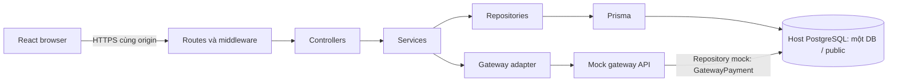
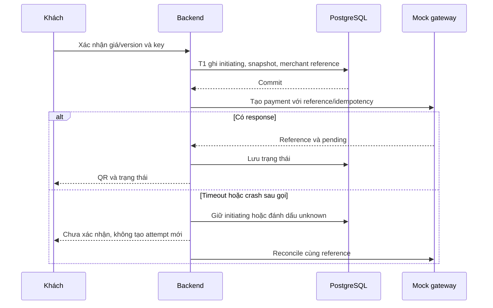
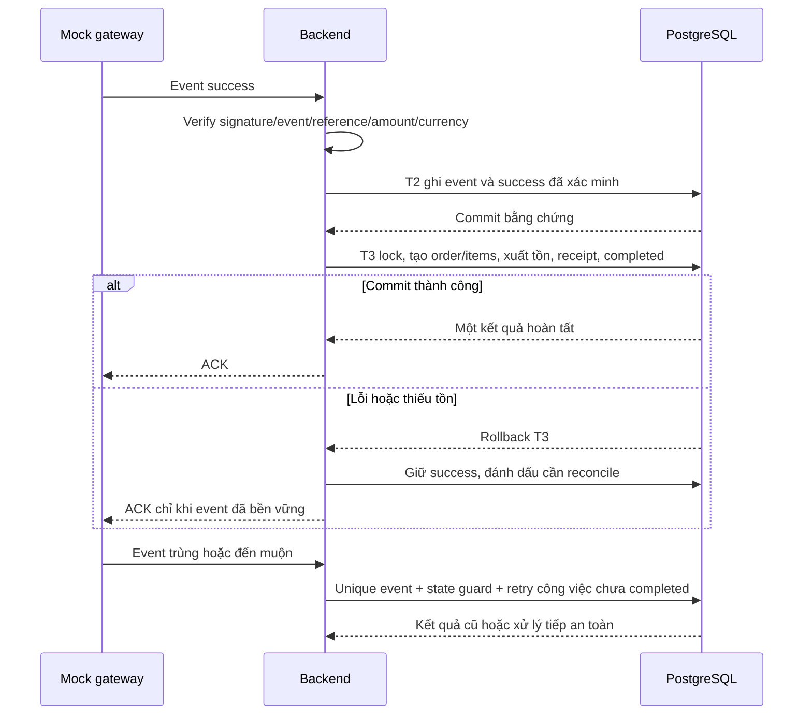

# Thiết kế kỹ thuật

## Kiến trúc đã chốt

Backend Express/TypeScript chia theo tầng kỹ thuật routes/controllers/services/repositories/middlewares; các thư mục validators/adapters/config/types/utils hỗ trợ trách nhiệm cụ thể. Frontend React/TypeScript/Vite; BE và PostgreSQL host riêng, Prisma chỉ kết nối từ phía server. Dùng một database/schema public chung chứa dữ liệu bán hàng và GatewayPayment. Mock gateway là process/API riêng theo D07, có thể chạy trên host BE, không yêu cầu thêm DB/schema/host.

Cấu trúc repo và trách nhiệm chuẩn tại [design/architecture.md](design/architecture.md). Source đã được refactor sang các tầng; app.ts chỉ composition, domain.ts/gateway.ts giữ export tương thích. Bằng chứng22 integration/14 E2E và restore local ở [giai đoạn3](progress/stage-3.md). Không đổi HTTP contract hoặc migration chỉ vì đổi cách đặt thư mục.

| Tầng                                   | Vai trò                                                                |
| -------------------------------------- | ---------------------------------------------------------------------- |
| routes                                 | Method/path và gắn middleware/controller, không Prisma                 |
| controllers                            | HTTP/DTO, không query DB hoặc điều phối transaction                    |
| services                               | Nghiệp vụ/quyền/transaction, không req/res                             |
| repositories                           | Prisma/SQL/locks/scope query, không commit riêng từng phần             |
| middlewares                            | Session/CSRF/auth/rate limit/lỗi; service vẫn kiểm tra quyền nghiệp vụ |
| validators/adapters/config/types/utils | Validate biên, tích hợp ngoài, cấu hình, DTO và helper thuần           |

Service hoàn tất đơn điều phối các repository order/inventory/payment bằng cùng transaction context. Không gọi gateway trong transaction DB. Không tạo phụ thuộc vòng; không thêm queue/cache/microservices khi chưa có nhu cầu đo được. Tách quyền runtime/migration không phải tách database.

NFR giữ nguyên: responsive/secure camera, quyền và ownership backend, atomicity/idempotency; mục tiêu lookup/cart khoảng2 giây và 10 phiên đồng thời chưa phải SLA production. p95, uptime và tải cần bằng chứng riêng.

## Auth và bảo mật

D06 đã chọn: browser cùng origin dùng opaque server session cookie lưu bền vững phía server, không dùng MemoryStore mặc định khi triển khai; tách proof khách và đăng nhập nhân sự. Cookie HttpOnly/Secure/SameSite, TTL/thu hồi rõ, CSRF cho mutation, origin allowlist. Nếu về sau đổi sang token, cần quyết định thay thế và ghi ADR về storage/rotation/revocation/CORS; không trộn hai cơ chế tùy tiện. Mọi cơ chế dùng thư viện được duy trì, không tự phát minh giao thức.

Mật khẩu nhân sự hash argon2id/bcrypt/scrypt qua thư viện chọn ở D01; không lưu plaintext hoặc hash nhanh trần. Login có rate limit và thông báo chung. API mỗi route có quyền chức năng và đối tượng theo [matrix](02-requirements.md); lọc ownership ngay trong query. Staff không có override payment hoặc giỏ. UUID không thay kiểm tra quyền.

Validate kiểu/độ dài/giới hạn tại biên; query tham số hóa; reject unknown fields; lỗi không lộ SQL/stack. Không có upload/fetch URL tùy ý trong MVP; image_url là metadata với allowlist origin nếu dùng ảnh ngoài. Giới hạn body, timeout, login/lookup/callback rate limit phải được D06/D07 chốt và test. TLS ở đích, DB app account tối thiểu, migration account riêng. Dependency scan và secret scan là required checks khi có code. Checklist bảo mật chưa có bằng chứng thực thi, chưa đạt G6.

## Payment và phục hồi lỗi

Mỗi request tạo payment có Idempotency-Key scope theo phiên/operation và payload digest; tạo reference bền vững trước gọi gateway. Cùng key/nội dung trả kết quả cũ; khác nội dung 409. Cả initiating, unknown và success chưa hoàn tất đều khóa attempt mới. Tạo/cập nhật trạng thái theo [state machine](02-requirements.md); tổng và snapshot từ backend, không tin số tiền browser gửi.

Crash trước T1 commit: chưa gọi gateway. Crash sau gọi nhưng trước lưu response: query theo merchant reference. Crash sau T2: job tìm event chưa processed hoặc payment success chưa completed. Crash sau T3 commit trước response: query/duplicate trả receipt cũ. Event sai thứ tự không hồi quy success; terminal mâu thuẫn chuyển xử lý đối soát, không tự ghi đè.

D05 đã chọn giữ hàng trước gọi gateway. Chuẩn bị payment giữ toàn bộ hàng trong transaction DB; success chuyển giữ hàng thành xuất bán cùng transaction hoàn tất; failure xác minh mới giải phóng. Conditional stock update đơn lẻ chưa đủ. Timeout/unknown không tự giải phóng reservation khi còn khả năng success. Poll backend có giới hạn và nút kiểm tra, không hứa realtime. Bản thử đã dùng timeout800ms, reconcile10s/max20 mỗi lượt theo design/states.md; đây là thông số demo, retry/backoff/lease và thời gian hỗ trợ ở đích chưa được nghiệm thu.

## Lỗi, log và cấu hình

Một middleware ánh xạ lỗi domain sang HTTP và `error.code/message/details/requestId`. Lists size20, page tối đa10000, sort/filter allowlist có index; money VND nguyên trong giới hạn2 tỷ ở implementation hiện tại, timestamps ISO 8601 UTC, JSON camelCase; tên model/cột thực theo Prisma schema. Dictionary bigint/snake_case trước đây là bản tham khảo. API riêng tại [03-api.md](03-api.md).

Log JSON tối thiểu timestamp/level/requestId/actorId/action/outcome; thêm sessionId/paymentId/orderId khi có. Audit product changes, auth bất thường và payment transition; không log password/token/proof/signature/raw sensitive body. Request ID trả header và lỗi. Health tách liveness/readiness, không trả cấu hình. Theo dõi latency/error rate, 5xx, pending lâu, success chưa completed, DB connections/disk và backup failures; ngưỡng và người nhận cảnh báo TBD trước G8.

Dev/test/staging/demo tách dữ liệu/quyền; cấu hình qua môi trường, secrets do runtime/secret store cấp, không commit cả credentials giả. Danh sách biến dự kiến: DATABASE_URL, SESSION_SECRET, PAYMENT_SECRET, GATEWAY_URL, CALLBACK_URL, PUBLIC_ORIGIN; migration dùng quyền riêng trên cùng database; nếu tạo `.env.example` thì mọi giá trị để trống. Tài liệu không chứa giá trị secret. Trước demo phải kiểm tra fail-fast khi thiếu config bắt buộc.

## ADR và quyết định đã chọn

| ADR / trạng thái                                             | Bối cảnh và lựa chọn                                                                                                                                        | Phương án không chọn / hệ quả                                                                  | Điều kiện xem lại                                         |
| ------------------------------------------------------------ | ----------------------------------------------------------------------------------------------------------------------------------------------------------- | ---------------------------------------------------------------------------------------------- | --------------------------------------------------------- |
| ADR-001 / kiến trúc tầng kỹ thuật ACCEPTED                   | Một backend chia routes/controllers/services/repositories/middlewares; BE kết nối một PostgreSQL database/schema public host riêng; GatewayPayment chung DB | Không chọn cây src/modules hoặc database/schema riêng cho mock; refactor code vẫn còn phải làm | Nhiều đội hoặc tải cần tách                               |
| ADR-002 / stack ACCEPTED, phiên bản working tree đã pin      | React/TypeScript/Vite + Express/TypeScript + PostgreSQL/Prisma                                                                                              | Working tree có package-lock; giữ bằng chứng build/test theo phiên bản đã chạy                 | Năng lực/hạ tầng thay đổi                                 |
| ADR-003 / ACCEPTED, thông số TBD                             | Session server/cookie cùng origin, khách không đăng ký, Staff/Admin login                                                                                   | Không chọn access/refresh token; cần CSRF, store bền vững, không dùng MemoryStore triển khai   | Mobile/khác origin/identity provider                      |
| ADR-004 / ACCEPTED                                           | Server reprice khi xác nhận, đổi giá khách đồng ý lại, freeze snapshot                                                                                      | Không giữ giá từ lúc thêm giỏ; cần UI xác nhận giá mới                                         | Nghiệp vụ cam kết giữ giá                                 |
| ADR-005 / ACCEPTED, expiry TBD                               | Reservation trước gateway, success xuất bán, failure xác minh mới giải phóng                                                                                | Không chọn payment trước rồi tranh tồn; tăng logic reservation/reconcile                       | Phạm vi hàng hóa/quy trình thay đổi                       |
| ADR-006 / mock gateway riêng ACCEPTED, cơ chế xử lý PROPOSED | Callback xác minh + query; thiết kế event bền vững/idempotency/reconcile                                                                                    | Không chọn sandbox nhà cung cấp lúc này; timeout/retry/signature contract còn thiếu            | Provider hoặc nhu cầu vận hành thay đổi                   |
| ADR-007 / chính sách ACCEPTED, công cụ TBD                   | Giao dịch suốt kỳ đồ án, log 30 ngày, backup hằng ngày giữ 7 bản; mục tiêu RPO ≤24h/RTO ≤60 phút                                                            | Chưa chọn PITR; phải restore thử để đo, không tự tuyên bố đạt                                  | Chuyển khỏi demo hoặc không chấp nhận mất dữ liệu gần đây |

Không bỏ quy tắc NÊN nào bằng suy đoán; ngoại lệ tương lai cần ADR có người/ngày, bối cảnh, lựa chọn, phương án loại, hệ quả và điều kiện xem lại.

## Điều kiện G6

D01/D03/D06 và cấu trúc tầng đã chọn; source thử/package-lock/migration và kiểm tra local đã có. Code đã refactor và kiểm chứng local; CI required checks và bằng chứng máy sạch/hosting vẫn cần hoàn thiện; chưa ký G6 PASS. Trước implementation: hoàn thiện thông số, duyệt contract S1, tạo OpenAPI, pin tools, dựng CI build/lint/format/unit/integration/migration. D04/D05/D07 đã chọn hướng xử lý; payment chỉ Ready sau khi contract giá/reservation/gateway, AC và test được hoàn thiện. Release/migration/backup/rollback xem [runbook](05-release.md); không triển khai hệ thống từ tài liệu dự thảo này.
