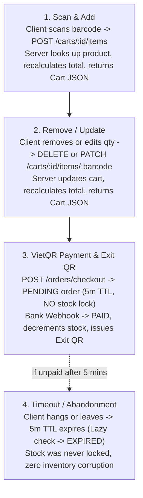

# Smart Self-Checkout (Phase 1: Smart Shopping) — System Specification

> **Architecture**: Centralized Client-Server (Shopper Mobile App/PWA + Cloud Backend)  
> **Base Path**: `/api/v1` | **Format**: `application/json` | **Currency**: Integer `VND`

---

## 1. Core Workflows



### Workflow 1: Scan & Add to Cart
1. Shopper opens the mobile app and calls `POST /carts` to start an active session (`cart_id`).
2. Shopper scans a product barcode with the phone camera.
3. App sends `POST /carts/{cart_id}/items` with `{ barcode, quantity: 1 }`.
4. Server looks up the product, adds/increments it in `cart_items`, recalculates `total_amount`, and returns the updated Cart JSON (or `404` if not found).
5. App renders the item, price, and running total with audio/haptic feedback.

### Workflow 2: Remove or Update Item
1. Shopper taps **Remove** or **`+` / `-`** on an item in the cart.
2. App calls `DELETE /carts/{cart_id}/items/{barcode}` (or `PATCH` with `{ quantity }`).
3. Server updates `cart_items`, recalculates `total_amount`, and returns the updated Cart JSON.
4. App re-renders the updated cart.

### Workflow 3: VietQR Payment, Bank Callback & Exit QR
1. Shopper taps **Pay** $\rightarrow$ App sends `POST /orders/checkout` (`Idempotency-Key` header + `{ cart_id }`).
2. Server creates an `orders` record in `PENDING` status with `expires_at = NOW() + 5 minutes` (**stock is NOT locked or decremented**), generates the VietQR image URL & banking deep link, and returns the Order JSON.
3. App displays the VietQR / **Open Bank App** button and polls `GET /orders/{order_id}/status` every 2 seconds.
4. Shopper confirms payment in their banking app $\rightarrow$ Payment gateway sends `POST /webhooks/payment` (signed with `X-Signature`).
5. Server verifies the HMAC signature, atomically marks the order `PAID`, **decrements `products.stock`**, and generates `exit_qr_payload`.
6. Next poll returns `PAID` + `receipt.exit_qr_payload` $\rightarrow$ App renders the **Payment Successful** screen with the Exit QR. *(Dev demo bypass: `POST /orders/{order_id}/pay`).*

### Workflow 4: Client Timeout / Abandonment (TTL Expiration)
1. If the shopper closes the app or does not pay within 5 minutes:
2. On the next `GET /orders/{order_id}/status` (lazy expiration check: `NOW() > expires_at`) or cleanup sweep, the server marks the order `EXPIRED`.
3. Because `products.stock` was never locked during `PENDING`, physical store inventory remains 100% accurate for other shoppers.
4. App renders *"Payment session expired. Return to cart to retry."*
*(Optional explicit abandonment: `DELETE /carts/{cart_id}` or `POST /orders/{order_id}/cancel`.)*

---

## 2. Database Schema (PostgreSQL)

```sql
CREATE TYPE order_status AS ENUM ('PENDING', 'PAID', 'EXPIRED', 'CANCELLED');

CREATE TABLE categories (
    id   SERIAL PRIMARY KEY,
    name VARCHAR(100) NOT NULL UNIQUE            -- e.g. 'Beverages', 'Snacks'
);

CREATE TABLE products (
    barcode     VARCHAR(64) PRIMARY KEY,
    category_id INT REFERENCES categories(id) ON DELETE SET NULL,
    name        VARCHAR(255) NOT NULL,
    price       INT NOT NULL CHECK (price >= 0),  -- Integer VND
    stock       INT NOT NULL DEFAULT 0,           -- Allowed < 0 on physical sale
    image_url   TEXT,
    is_active   BOOLEAN NOT NULL DEFAULT TRUE
);

CREATE TABLE carts (
    id         VARCHAR(64) PRIMARY KEY,           -- e.g. CRT-9f8e7d6c
    store_id   VARCHAR(32) NOT NULL,
    status     VARCHAR(16) NOT NULL DEFAULT 'ACTIVE', -- ACTIVE | ABANDONED | CHECKED_OUT
    created_at TIMESTAMPTZ DEFAULT NOW()
);

CREATE TABLE cart_items (
    cart_id  VARCHAR(64) REFERENCES carts(id) ON DELETE CASCADE,
    barcode  VARCHAR(64) REFERENCES products(barcode),
    quantity INT NOT NULL CHECK (quantity > 0),
    PRIMARY KEY (cart_id, barcode)
);

CREATE TABLE orders (
    id           VARCHAR(64) PRIMARY KEY,         -- e.g. ORD-20261127-001
    cart_id      VARCHAR(64) REFERENCES carts(id),
    total_amount INT NOT NULL CHECK (total_amount >= 0),
    status       order_status NOT NULL DEFAULT 'PENDING',
    created_at   TIMESTAMPTZ DEFAULT NOW(),
    paid_at      TIMESTAMPTZ,
    expires_at   TIMESTAMPTZ NOT NULL             -- created_at + 5 minutes
);

CREATE TABLE order_items (
    id           SERIAL PRIMARY KEY,
    order_id     VARCHAR(64) REFERENCES orders(id) ON DELETE CASCADE,
    barcode      VARCHAR(64) REFERENCES products(barcode),
    product_name VARCHAR(255) NOT NULL,           -- Frozen snapshot at purchase
    unit_price   INT NOT NULL,                    -- Frozen snapshot at purchase
    quantity     INT NOT NULL CHECK (quantity > 0),
    subtotal     INT NOT NULL
);

CREATE TABLE payment_transactions (
    id             VARCHAR(64) PRIMARY KEY,
    order_id       VARCHAR(64) REFERENCES orders(id),
    provider       VARCHAR(32) NOT NULL DEFAULT 'VIETQR',
    amount         INT NOT NULL,
    reference_memo VARCHAR(64) NOT NULL,
    status         VARCHAR(16) NOT NULL,          -- SUCCESS | FAILED
    created_at     TIMESTAMPTZ DEFAULT NOW()
);

CREATE INDEX idx_products_category_id ON products(category_id);
CREATE INDEX idx_orders_status ON orders(status);
CREATE INDEX idx_order_items_order_id ON order_items(order_id);
```

---

## 3. REST API Contracts (`/api/v1`)

### Shopper Endpoints (Public)

| Method & Path | Request | Response | Notes |
| :--- | :--- | :--- | :--- |
| `POST /carts` | `{ "store_id" }` | `201`: `{ cart_id, items: [], total_amount: 0 }` | Starts shopping session |
| `POST /carts/{id}/items` | `{ "barcode", "quantity" }` | `200`: `{ cart_id, items, total_amount }` | `404` if barcode unknown |
| `PATCH /carts/{id}/items/{barcode}` | `{ "quantity" }` | `200`: `{ cart_id, items, total_amount }` | Updates quantity |
| `DELETE /carts/{id}/items/{barcode}` | — | `200`: `{ cart_id, items, total_amount }` | Removes item from cart |
| `DELETE /carts/{id}` | — | `200`: `{ status: "ABANDONED" }` | *(Optional)* Explicit cart abandon |
| `POST /orders/checkout` | `{ "cart_id" }` *(+ `Idempotency-Key`)* | `201`: `{ order_id, status: "PENDING", total_amount, vietqr: { qr_url, deep_link }, expires_at }` | Creates order; **no stock lock** |
| `GET /orders/{id}/status` | — | `200`: `{ order_id, status: "PENDING" \| "PAID" \| "EXPIRED", receipt?: { exit_qr_payload } }` | Polled every 2s; lazy TTL check |
| `POST /orders/{id}/cancel` | — | `200`: `{ order_id, status: "CANCELLED" }` | *(Optional)* Explicit payment cancel |
| `POST /orders/{id}/pay` | `{ "provider": "SIMULATED" }` | `200`: Same as `PAID` status response | Classroom demo bypass |

### Payment Gateway Webhook

| Method & Path | Auth / Header | Request | Response / Action |
| :--- | :--- | :--- | :--- |
| `POST /webhooks/payment` | `X-Signature` (HMAC) | `{ order_id, amount, transaction_id }` | Marks `PAID`, **decrements `products.stock`**, issues Exit QR |

---

## 4. Core Business Rules

1. **No Stock Lock on `PENDING`**: Stock only decrements when `PAID` is confirmed; physical possession prevents false blocking.
2. **Server-Authoritative Pricing**: Client never sends prices; all totals are computed server-side in integer `VND`.
3. **Immutable Purchase Snapshots**: `order_items` freezes `product_name` and `unit_price` at checkout.
4. **Idempotent Webhooks**: Duplicate bank callbacks never decrement stock twice.
